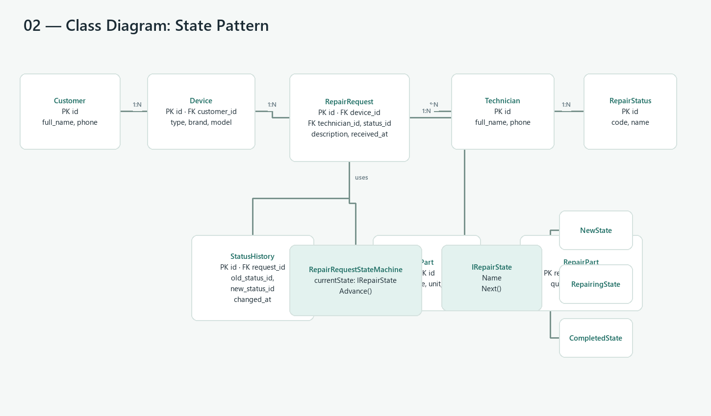
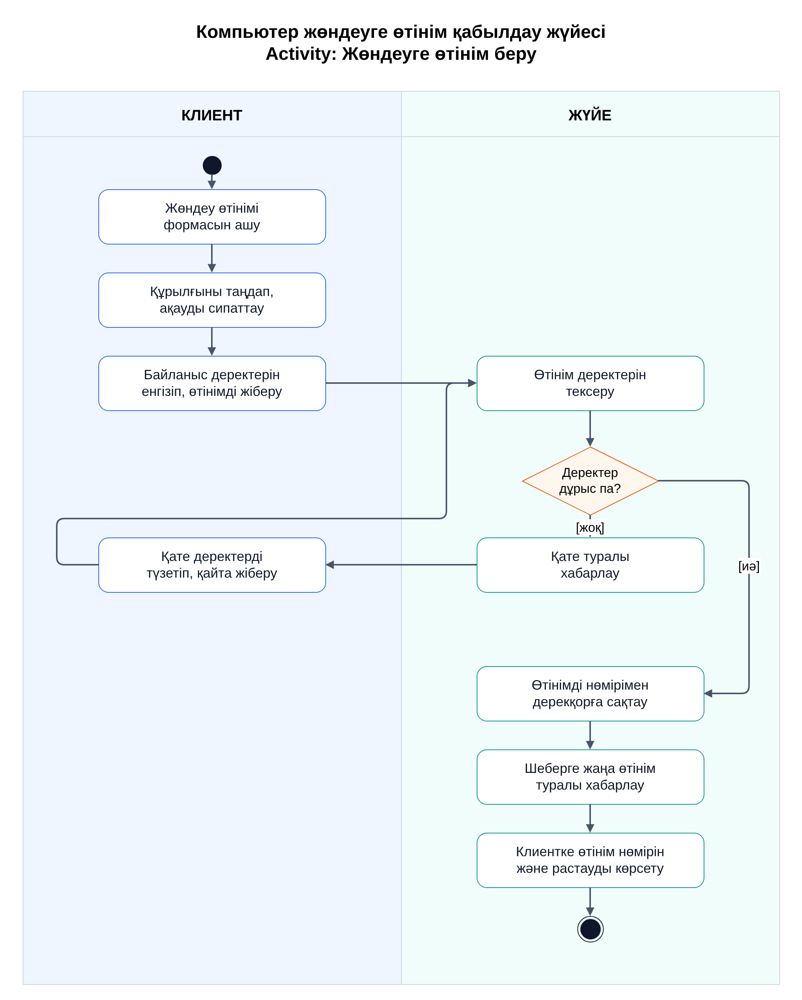
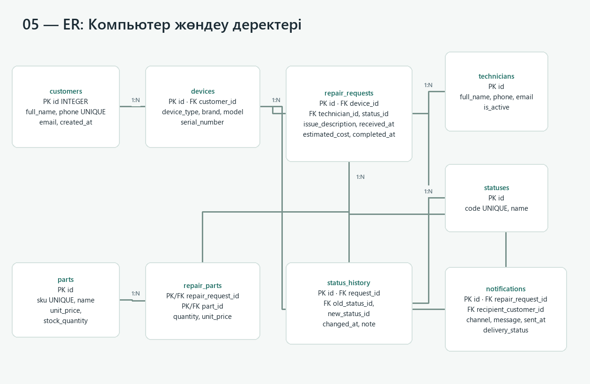
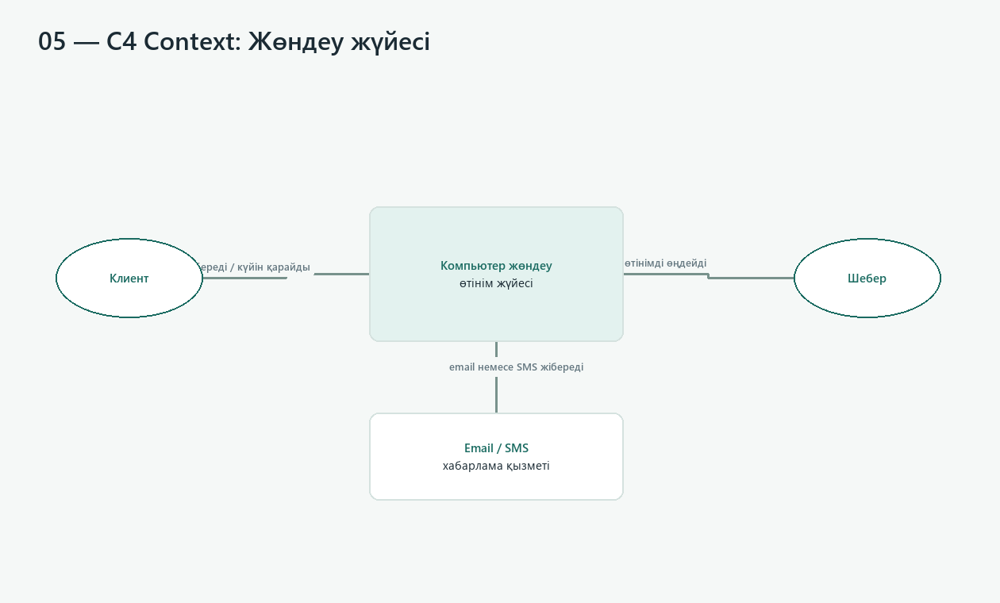
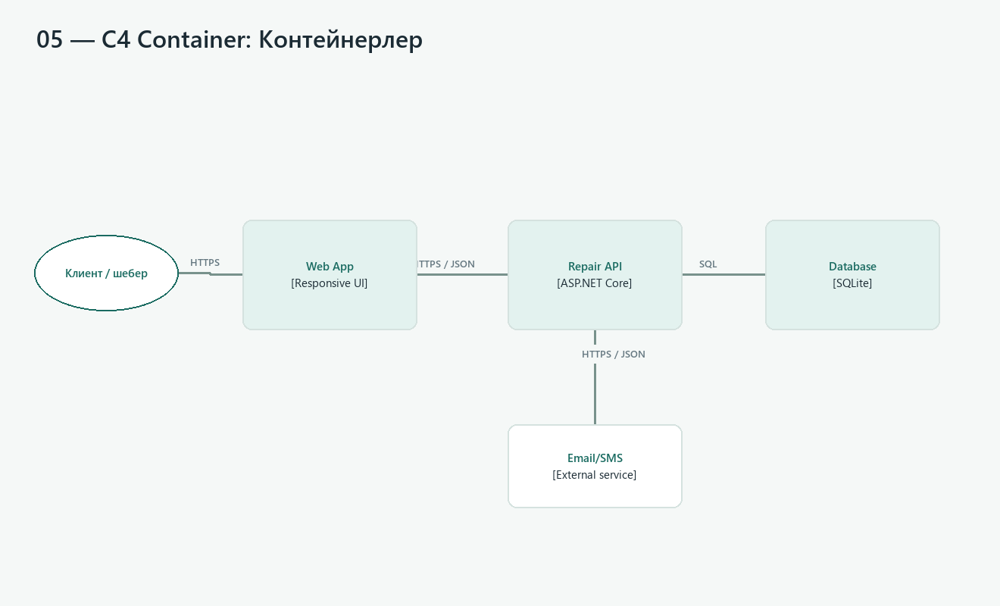
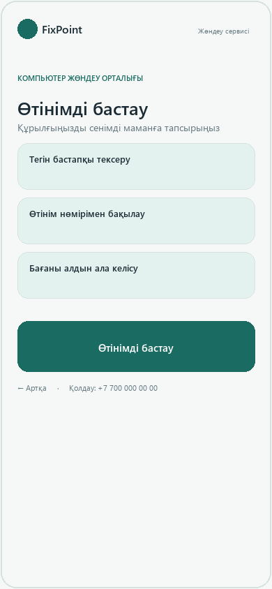

# Компьютер жөндеуге өтінім қабылдау жүйесі

**Автор:** Ембергенов Қазбек  
**Топ:** ВТиПО

## Мәселе

Компьютер жөндеу орталығында телефон немесе мессенджер арқылы түскен өтінімдер жоғалып, құрылғы ақауы мен клиенттің байланыс деректері толық тіркелмеуі мүмкін. Жүйе клиентке жөндеуге өтінім беруге, ал шеберге өтінімді қабылдап, өңдеуге көмектеседі. Әр өтінімге жеке нөмір беріледі.

## Акторлар

- **Клиент** — құрылғысын, ақауды және байланыс деректерін көрсетіп, өтінім береді.
- **Шебер** — өтінімді тексеріп, диагностика мен жөндеу мәртебесін жаңартады.

## Репозиторий құрылымы

```text
diploma-computer-repair/
├── README.md
├── prototype.txt
├── diagrams/
│   ├── 01-usecase.drawio / .png
│   ├── 02-class.drawio / .png
│   ├── 03-activity.drawio / .png
│   ├── 04-sequence.drawio / .png
│   ├── 05-er.drawio / .png
│   ├── 05-c4-context.drawio / .png
│   ├── 05-c4-container.drawio / .png
│   └── ui/                 # Figma прототипінің экрандары
├── db/
│   ├── schema.sql
│   └── queries.sql
├── code/
├── docs/
│   ├── tests.md
│   └── quality.md
└── src/                    # кейінгі жоба коды
```

## 1. Use Case


## 2. Class



## 3. Activity: жөндеуге өтінім беру



Бұл сценарийде клиент құрылғы мен ақау деректерін енгізеді. Жүйе міндетті өрістерді тексереді, дұрыс өтінімді нөмірмен сақтап, клиентке растау береді.

## 4. Sequence: өтінімді өңдеу


Өңделетін Draw.io диаграммалары `diagrams/` ішінде сақталған. PNG файлдары README-де тікелей көрсетіледі.

## 5. Деректер қоры және архитектура

### ER диаграммасы



Деректер қоры: [db/schema.sql](db/schema.sql), [db/queries.sql](db/queries.sql). SQLite сызбасында 9 мән, PK/FK, тексеру шектеулері және әр кестеге кемінде 5 тест жазба бар.

### C4 Context



Жүйемен клиент пен шебер жұмыс істейді. Сыртқы email/SMS қызметі өтінім мәртебесі туралы хабарлама жібереді.

### C4 Container



Контейнерлер: Responsive Web App, ASP.NET Core API және SQLite дерекқоры. Байланыстар HTTPS/JSON және SQL арқылы жүреді.

## 6. Интерфейс, жобалау үлгісі және сапа

### Figma прототипі

Figma: [өтінім беру және мәртебені бақылау прототипі](https://www.figma.com/proto/bR5C71Pr3xbABKug32ksed/Computer-Repair-Request---Prototype?node-id=4-10&starting-point-node-id=4%3A10&scaling=scale-down). Экран суреттері `diagrams/ui/` ішінде сақталған. Figma файлында қарау рұқсатын ортақ сілтемесі бар кез келген адамға ашу керек.



### State үлгісі

Өтінім күйлерін ауыстыру үлгісі [code/RepairRequestState.cs](code/RepairRequestState.cs) файлында берілген. Class диаграммасына `RepairRequestStateMachine` және `IRepairState` қосылды.

### Тест-кейстер және сапа

- [Интерфейс тест-кейстері](docs/tests.md) — 15 кейс, оның ішінде қате және рұқсатсыз әрекеттер.
- [SOLID, STRIDE және өнімділік талаптары](docs/quality.md).


