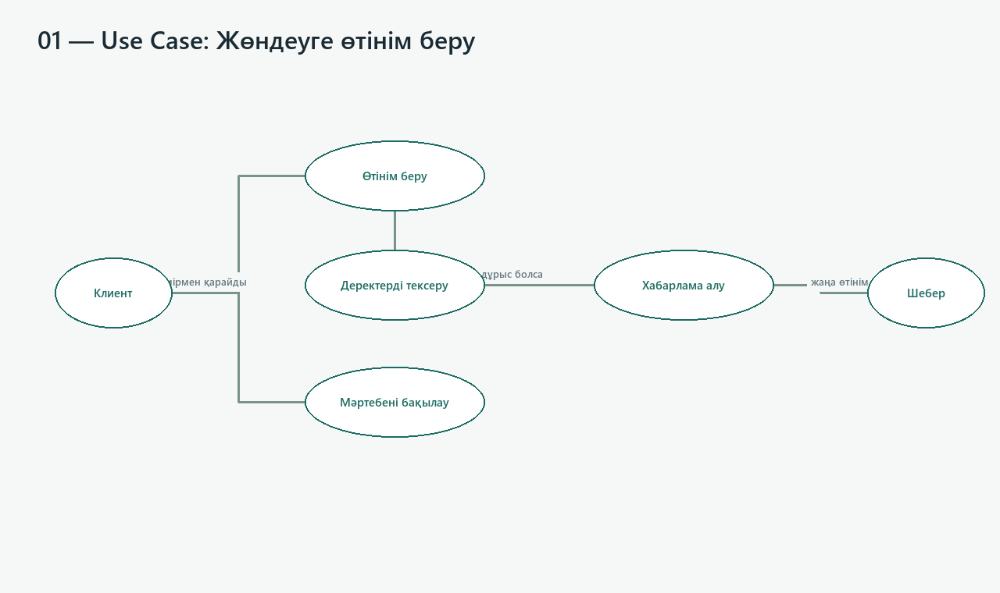
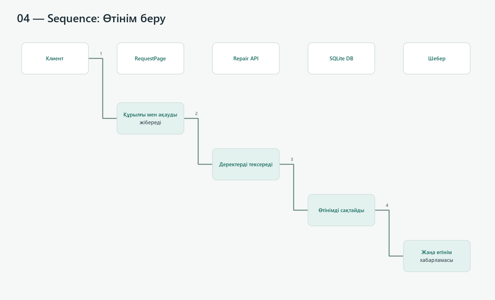

# Компьютер жөндеуге өтінім қабылдау жүйесі

**Автор:** Ембергенов Қазбек  
**Топ:** ВТиПО

## Мәселе

Компьютер жөндеу орталығында телефон немесе мессенджер арқылы түскен өтінімдер жоғалып, құрылғы ақауы мен клиенттің байланыс деректері толық тіркелмеуі мүмкін. Жүйе клиентке жөндеуге өтінім беруге, ал шеберге өтінімді қабылдап, өңдеуге көмектеседі. Әр өтінімге жеке нөмір беріледі.

## Акторлар

- **Клиент** — құрылғысын, ақауды және байланыс деректерін көрсетіп, өтінім береді.
- **Шебер** — өтінімді тексеріп, диагностика мен жөндеу мәртебесін жаңартады.

## Репозиторий құрылымы

```text
diploma-computer-repair/
├── README.md
├── prototype.txt
├── diagrams/
│   ├── 01-usecase.drawio / .png
│   ├── 02-class.drawio / .png
│   ├── 03-activity.drawio / .png
│   ├── 04-sequence.drawio / .png
│   ├── 05-er.drawio / .png
│   ├── 05-c4-context.drawio / .png
│   ├── 05-c4-container.drawio / .png
│   └── ui/                 # Figma прототипінің экрандары
├── db/
│   ├── schema.sql
│   └── queries.sql
├── code/
├── docs/
│   ├── tests.md
│   └── quality.md
└── src/                    # кейінгі жоба коды
```

## 1. Use Case



## 2. Class


## 3. Activity: жөндеуге өтінім беру


Бұл сценарийде клиент құрылғы мен ақау деректерін енгізеді. Жүйе міндетті өрістерді тексереді, дұрыс өтінімді нөмірмен сақтап, клиентке растау береді.

## 4. Sequence: өтінімді өңдеу



Өңделетін Draw.io диаграммалары `diagrams/` ішінде сақталған. PNG файлдары README-де тікелей көрсетіледі.

## 5. Деректер қоры және архитектура

5-жұмыстың ER және C4 диаграммалары, SQL файлдары төменде қосылады.


